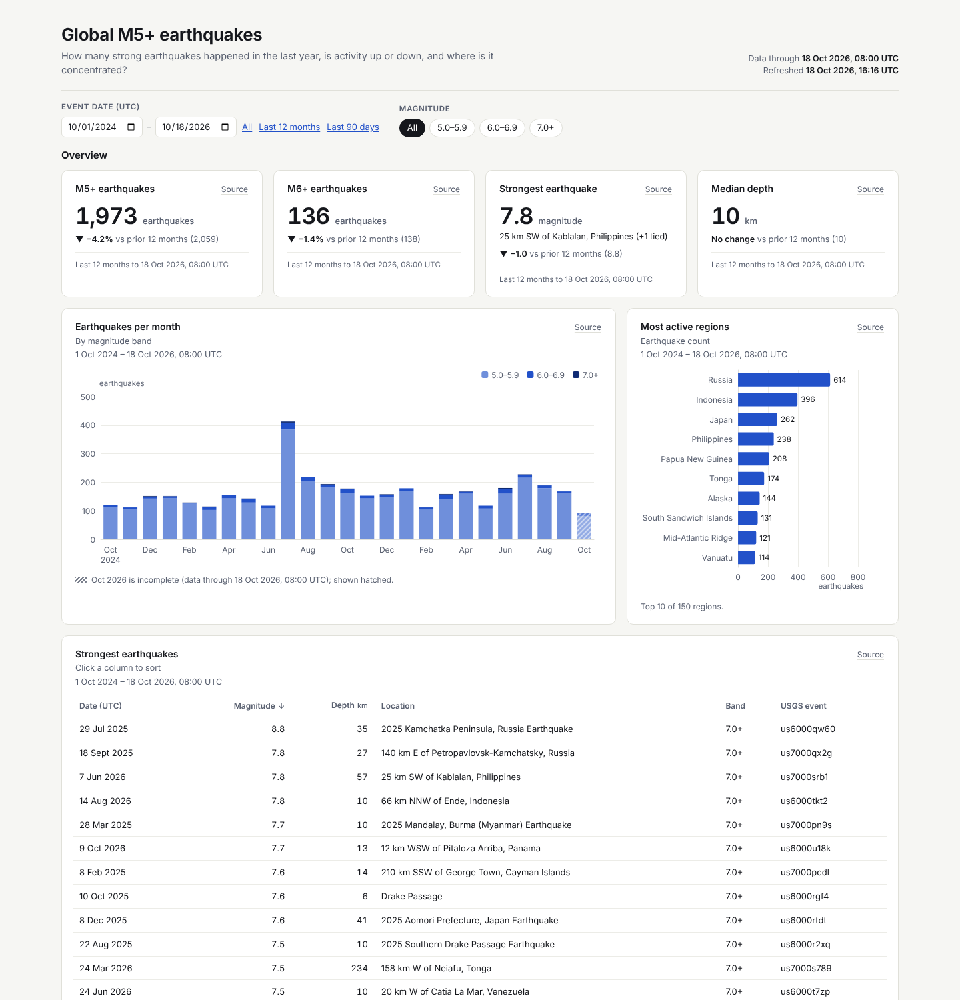

# data-dash

Traceable dashboards for AI agents. You (or your agent) describe the dashboard in a YAML spec; data-dash builds **one self-contained HTML file** that opens offline. Every number is clickable to the query, rows, freshness and CSV behind it. It also exports PNG (desktop + mobile) and PDF and audits the page with an automated checklist.



*The bundled real-data example: global M5+ earthquakes from the USGS ComCat feed (public domain).*

Sibling skill: [**frame-motion**](https://github.com/venthewise/frame-motion), code-only motion graphics rendered to MP4.

- Sources: CSV, Excel (xlsx), Parquet, JSON, HTTP APIs, Google Sheets (published CSV), SQLite, DuckDB, and **snapshots** written by an agent from any connector (mail, CRM, analytics, issue trackers…).
- Works with any agent that supports [Agent Skills](https://agentskills.io/specification), and with agents that don't (see below).

## Requirements

| What | Needed for | Notes |
|---|---|---|
| Python **3.10+** | everything | |
| `duckdb`, `pyyaml` | `refresh`, `build` | core |
| `playwright` + Playwright Chromium | `check` (browser checks), `export` (PNG/PDF) | `check --no-browser` runs only the static checks |
| `openpyxl` | only `xlsx` sources | optional |
| `tzdata` | only `display_tz` on Windows | Windows has no system time-zone database |
| Network | only URL sources, on `refresh` | built HTML works offline |

No ffmpeg, Node or jinja2 needed. ECharts and the Inter font subset are vendored in `assets/`.

## Install (one time)

### macOS / Linux (bash)

```bash
# macOS:  brew install python
# Debian/Ubuntu:  sudo apt install -y python3 python3-pip python3-venv
python3 -m venv .venv && source .venv/bin/activate
python3 -m pip install duckdb pyyaml playwright   # + openpyxl for xlsx, + tzdata on Windows for display_tz
python3 -m playwright install chromium            # Linux: add --with-deps for system libraries
```

### Windows (PowerShell)

```powershell
winget install -e --id Python.Python.3.12
py -3 -m venv .venv; .\.venv\Scripts\Activate.ps1
python -m pip install duckdb pyyaml playwright   # + openpyxl for xlsx, + tzdata on Windows for display_tz
python -m playwright install chromium
```

On Windows use `python` (or `py -3`), not `python3`: `python3` may open the Microsoft Store alias. Commands in this README use `python3`; replace it with `python` on Windows. Paths with `/` work in PowerShell.

## Install for your agent

This repository **is** the skill: its root holds `SKILL.md` plus `scripts/`, `references/`, `examples/` and `assets/` (a standard [Agent Skills](https://agentskills.io/specification) folder). Install it by cloning or copying the repo folder into a skills directory your agent scans. The folder must be named `data-dash` (it has to match `name:` in `SKILL.md`).

Get it:

```bash
git clone https://github.com/venthewise/data-dash.git        # or download data-dash.zip and unzip it
```


| Agent | Personal (all projects) | Project (commit to repo) | Invoke | Status |
|---|---|---|---|---|
| Claude Code | `~/.claude/skills/data-dash/` (Windows: `%USERPROFILE%\.claude\skills\data-dash\`) | `.claude/skills/data-dash/` | auto, or `/data-dash` | verified ([docs](https://code.claude.com/docs/en/skills), [.claude dir](https://code.claude.com/docs/en/claude-directory)) |
| Claude apps (claude.ai, desktop) | enable Settings → Capabilities → *Code execution and file creation*, then Customize → Skills → + → Create skill → Upload a skill, and pick `data-dash.zip` (the release zip, with a top-level `data-dash/` folder) | – | auto | upload steps verified ([help center](https://support.claude.com/en/articles/12512180-use-skills-in-claude)); whether Claude's sandbox has the Python packages, Chromium it needs is **not verified** |
| OpenAI Codex (CLI, IDE extension, ChatGPT desktop app) | `$HOME/.agents/skills/data-dash/` | `.agents/skills/data-dash/` (any folder from CWD up to the repo root) | auto, `/skills`, or `$data-dash` | verified ([docs](https://developers.openai.com/codex/skills)). `~/.codex/skills` is **not** listed in the Codex docs |
| Cursor | `~/.cursor/skills/data-dash/` or `~/.agents/skills/data-dash/` | `.cursor/skills/data-dash/` or `.agents/skills/data-dash/` | auto, or `/data-dash` | verified ([docs](https://cursor.com/docs/skills)); also reads `.claude/skills` and `.codex/skills` |
| Gemini CLI | `~/.gemini/skills/data-dash/` or `~/.agents/skills/data-dash/` | `.gemini/skills/data-dash/` or `.agents/skills/data-dash/` (workspace must be trusted: `/trust`) | auto; check with `/skills list`, `/skills reload` | verified ([docs](https://github.com/google-gemini/gemini-cli/blob/main/docs/cli/skills.md), [tutorial](https://github.com/google-gemini/gemini-cli/blob/main/docs/cli/tutorials/skills-getting-started.md)) |
| Grok Build CLI (xAI) | `~/.grok/skills/data-dash/` or `~/.agents/skills/data-dash/` | `.grok/skills/data-dash/` (walked up to the repo root) | auto, or `/data-dash` | verified ([docs](https://docs.x.ai/build/features/skills-plugins-marketplaces)); also reads Claude Code skill folders |
| Other agents with Agent Skills support | the agent's skills folder | – | – | check the agent's docs |

**One folder for most agents:** `~/.agents/skills/` (or `.agents/skills/` in a repo) is read by Codex, Cursor, Gemini CLI and Grok Build. Claude Code reads `~/.claude/skills/`, which can be a symlink to the same folder.

macOS / Linux:
```bash
mkdir -p ~/.agents/skills ~/.claude/skills
git clone https://github.com/venthewise/data-dash.git ~/.agents/skills/data-dash   # or: cp -R data-dash ~/.agents/skills/
ln -s ~/.agents/skills/data-dash ~/.claude/skills/data-dash                         # optional: Claude Code
```

Project-scoped instead: clone or copy it to `.agents/skills/data-dash` (or `.claude/skills/data-dash`, `.cursor/skills/data-dash`, `.gemini/skills/data-dash`, `.grok/skills/data-dash`) inside your repo.

Windows PowerShell:
```powershell
New-Item -ItemType Directory -Force "$HOME\.agents\skills", "$HOME\.claude\skills" | Out-Null
git clone https://github.com/venthewise/data-dash.git "$HOME\.agents\skills\data-dash"   # or Copy-Item -Recurse .\data-dash ...
Copy-Item -Recurse -Force "$HOME\.agents\skills\data-dash" "$HOME\.claude\skills\"    # Claude Code (or use a junction)
```

Restart the agent (or reload skills) after installing.

### Agents without skill support

The skill still works: it is plain Markdown plus Python scripts.

- **Point the agent at it:** "Read `path/to/data-dash/SKILL.md` and follow it for this task. Run its scripts from that folder."
- **Or reference it in `AGENTS.md`** (read by Codex, Cursor, Gemini CLI, Grok Build and others) or your agent's rules file:

```markdown
## Skills
- data-dash: see `tools/data-dash/SKILL.md`. Read it before any task it describes, and
  run its scripts with paths relative to that folder (`tools/data-dash/scripts/...`).
```

- **Chat-only assistants** (no shell): paste `SKILL.md` as instructions; the assistant can write the spec/scene, and you run the commands locally.

## Quick start

From the skill folder (`cd data-dash`):

```bash
# Offline example: connector-style snapshot with fake EXAMPLE numbers
python3 scripts/dash.py all examples/usage-snapshot/spec.yaml --outdir out/usage

# Real data: USGS M5+ earthquakes (offline: bundled public-domain snapshot)
python3 scripts/dash.py all examples/usgs-earthquakes/spec.yaml --outdir out/usgs

# Your own: scaffold a spec + seeded synthetic data, then edit spec.yaml
python3 scripts/dash.py init my-dash && python3 scripts/dash.py all my-dash/spec.yaml --outdir my-dash/out
```

Each `all` run writes `index.html`, `desktop.png`, `mobile.png` and `dashboard.pdf` to `--outdir`, and prints the checklist (it exits 1 on any FAIL).

With an agent, just ask: *"Use data-dash to build a dashboard from sales.csv: revenue, orders, trend by month, top products."*

## Commands

`python3 scripts/dash.py <command> -h` shows every flag.

| Command | What it does |
|---|---|
| `init <dir>` | scaffold `spec.yaml` + `sample/orders.csv` (seeded synthetic EXAMPLE data) |
| `refresh <spec> [--offline]` | load the sources and run each dataset query (URL downloads cached in `.cache/`). `--offline` reuses cached downloads |
| `build <spec> [--out f.html]` | write one self-contained HTML file |
| `check <spec\|html> [--no-browser]` | audit the dashboard with an automated checklist (exit 1 on any FAIL) |
| `export <html> [--png] [--mobile] [--pdf] [--active-only]` | full-page PNG at 1440 px and 390 px @2x, A4 landscape PDF |
| `all <spec> [--outdir d] [--offline] [--no-export]` | refresh → build → check → export |

The spec format is in [`references/spec-reference.md`](references/spec-reference.md); chart and layout rules are in [`references/design-rules.md`](references/design-rules.md). The agent-facing workflow is in [`SKILL.md`](SKILL.md).

**Connector data** (anything only an agent can reach): the agent pulls it with its own tool and saves a snapshot file, referenced as `type: snapshot`. See `examples/usage-snapshot/`.

**Privacy:** the HTML embeds every row of every dataset it uses. Check the rows before sharing or publishing a dashboard.

## Sandbox notes

- **Network:** some agents run commands with network off by default (for example Codex's default `workspace-write` sandbox, [docs](https://learn.chatgpt.com/docs/agent-approvals-security)). `pip install`, `playwright install chromium` and the first `refresh` of a URL source need network: run them yourself, approve the command, or enable network for the session. After one online refresh, `refresh --offline` (or `all --offline`) works without network. Both bundled examples and `init` never need network.
- **Chromium:** `check` and `export` launch headless Chromium. Some sandboxes block it (missing system libraries, or OS sandbox restrictions). On Linux, install deps with `python3 -m playwright install --with-deps chromium`. If it still can't launch inside the agent sandbox, run `check`/`export` outside it, or use `check --no-browser` for the static checks only.
- **Writes:** `refresh` writes `data/` and `.cache/` next to the spec; `build`/`export` write where `--out`/`--outdir` point.

## Troubleshooting

| Problem | Fix |
|---|---|
| `data/<id>.json missing` on build | run `refresh` (or `all`) first |
| `--offline: no cached download` | run one `refresh` without `--offline` (needs network) |
| `download failed` | network blocked in the sandbox, or the URL is down; see Sandbox notes |
| `check`: hard-coded number in text | move the number into data, or list defined terms (e.g. `M5+`) in `dashboard.allow_terms` |
| `check`: units missing | add `units:`, a `percent`/`currency` format, or `unitless: true` on a table column |
| `display_tz ... is not an IANA time zone` | use a name like `Europe/London`; on Windows `pip install tzdata` |
| Playwright: `Executable doesn't exist` | `python3 -m playwright install chromium` |
| Chromium fails to launch on Linux | `python3 -m playwright install --with-deps chromium` |
| `python3` not found / opens the Store (Windows) | use `python` or `py -3` |
| Page heavy | aggregate in SQL to the grain the widgets need |

## Examples and data

- `examples/usgs-earthquakes/`: real data from the [USGS Earthquake Hazards Program](https://earthquake.usgs.gov/fdsnws/event/1/) ComCat feed, bundled as `snapshots/usgs-m5.json`: a trimmed snapshot of 4,110 M5+ earthquakes from **1 Oct 2024 to 18 Oct 2026 08:00 UTC** (columns id, time, mag, depth, place; about 335 KB). It builds offline on first run. USGS data is a U.S. Government work in the **public domain** ([USGS copyright policy](https://www.usgs.gov/information-policies-and-instructions/copyrights-and-credits)). For live data, swap in the URL source shown in the spec's header comment and run with network.
- `examples/usage-snapshot/`: **fake, seeded EXAMPLE numbers** shaped like a usage-connector pull (tokens, requests, cost by product/agent/model). Not real usage or prices.

## License

MIT, see [`LICENSE`](LICENSE). Bundled third-party assets keep their own licences (see [`NOTICE`](NOTICE) and [`assets/LICENSES.md`](assets/LICENSES.md)):

- Apache ECharts 6.1.0: Apache License 2.0 (`assets/ECharts-LICENSE.txt`, `assets/ECharts-NOTICE.txt`); includes d3.js-derived code under BSD 3-Clause (`assets/ECharts-LICENSE-d3.txt`).
- Inter font (Latin subset): SIL Open Font License 1.1 (`assets/Inter-OFL.txt`).

## Credits

- Author: Paolo Libertad ([@venthewise](https://github.com/venthewise)). See also the sibling skill [frame-motion](https://github.com/venthewise/frame-motion).
- Inspired by Anthropic's Claude Dashboards; an independent project, not affiliated with Anthropic.
